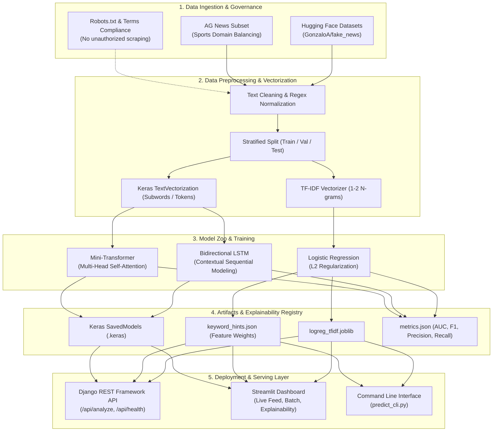

# NLP-Based Fake News Detection & Content Credibility Analysis System

[](LICENSE)
[](https://www.python.org/downloads/)
[](https://www.tensorflow.org/)
[](https://scikit-learn.org/)
[](https://streamlit.io/)
[](https://www.djangoproject.com/)
[](https://github.com/Saish-aher-28/NLP-based-fake-news-detection-system/actions/workflows/ci.yml)
[](https://github.com/Saish-aher-28/NLP-based-fake-news-detection-system/actions/workflows/codeql.yml)

An enterprise-ready, end-to-end Natural Language Processing (NLP) system designed to audit, score, and detect misinformation in draft news articles before publication. The platform integrates classical machine learning, deep sequence models (BiLSTM), and self-attention Transformer networks with model explainability, a real-time Streamlit dashboard, a robust Django REST API, and DevSecOps pipelines.

---

## Table of Contents

- [Overview & Motivation](#overview--motivation)
- [System Architecture](#system-architecture)
- [End-to-End Workflow](#end-to-end-workflow)
- [Model Zoo & NLP Architectures](#model-zoo--nlp-architectures)
- [Evaluation & Benchmark Results](#evaluation--benchmark-results)
- [Explainable AI (XAI) & Interpretability](#explainable-ai-xai--interpretability)
- [Platform Interfaces](#platform-interfaces)
  - [1. Streamlit Interactive Dashboard](#1-streamlit-interactive-dashboard)
  - [2. Django Web & REST API](#2-django-web--rest-api)
  - [3. CLI Batch Scorer](#3-cli-batch-scorer)
- [Tech Stack](#tech-stack)
- [Repository Structure](#repository-structure)
- [Getting Started](#getting-started)
  - [Prerequisites](#prerequisites)
  - [Local Installation](#local-installation)
  - [Quick Commands](#quick-commands)
- [API Reference](#api-reference)
- [CI/CD & Security Auditing](#cicd--security-auditing)
- [Ethical Considerations & Best Practices](#ethical-considerations--best-practices)
- [Author & License](#author--license)

---

## Overview & Motivation

The proliferation of digital misinformation presents a critical challenge to media integrity, editorial compliance, and public trust. Modern content management systems (CMS) and newsrooms require automated triage mechanisms that highlight suspicious claims, clickbait phrasing, and unreliable text patterns without imposing editorial bottlenecks.

This project implements a **human-in-the-loop decision-support system** that:
1. **Analyzes draft news text** across multiple lexical and contextual dimensions.
2. **Generates confidence-calibrated credibility scores** indicating whether an article requires manual editorial review.
3. **Surfaces interpretable lexical cues (keyword hints)** so reviewers understand the exact phrases driving model decisions.
4. **Ingests real-time RSS feeds** to monitor and score live news streams from global outlets.

---

## System Architecture

The following diagram illustrates the complete data lifecycle, training pipeline, model registry, and client interfaces:



---

## End-to-End Workflow

1. **Dataset Ingestion**: Curates news items from verified open research datasets (`GonzaloA/fake_news` merged with domain-balanced sports rows from `ag_news`), enforcing data compliance by avoiding unpermissioned web scraping.
2. **Text Normalization**: Strips formatting artifacts, normalizes punctuation, extracts headline-body interactions, and produces standardized training splits (`train.csv`, `val.csv`, `test.csv`).
3. **Multi-Model Training**:
   - Vectorizes text through TF-IDF and deep token embedding layers.
   - Fits linear and deep learning classifiers using early stopping and regularization.
   - Evaluates generalization gap across holdout sets to diagnose overfitting.
4. **Artifact Compilation**: Exports model binaries alongside feature weight distributions (`keyword_hints.json`) and audit logs (`metrics.json`).
5. **Real-Time Scoring & Explanation**: Ingests new drafts via REST API, Streamlit, or CLI; calculates posterior probability $P(\text{unreliable})$; tags key predictive phrases; and flags items exceeding the customizable threshold.

---

## Model Zoo & NLP Architectures

The system implements three distinct modeling strategies to balance latency, resource footprint, and predictive accuracy:

### 1. Classical Baseline: TF-IDF + Logistic Regression
- **Feature Extraction**: Sub-linear term frequency, inverse document frequency (TF-IDF) over unigrams and bigrams ($1 \le n \le 2$).
- **Classifier**: High-dimensional Logistic Regression with L2 penalty.
- **Latency**: Sub-millisecond ($< 5\text{ ms}$), CPU-bound inference.
- **Strength**: High transparency; direct coefficient inspection allows immediate extraction of deceptive vs. credible lexical indicators.

### 2. Deep Sequence Model: Bidirectional LSTM
- **Architecture**: Embedding layer followed by bidirectional recurrent LSTM cells.
- **Mechanics**: Computes forward and backward hidden representations:
  $$\vec{h}_t = \text{LSTM}(x_t, \vec{h}_{t-1}), \quad \overleftarrow{h}_t = \text{LSTM}(x_t, \overleftarrow{h}_{t+1})$$
- **Strength**: Retains long-range syntactic structure, clause dependencies, and negation context often missed by bag-of-words approaches.

### 3. Attention Architecture: Mini-Transformer
- **Architecture**: Multi-Head Self-Attention block paired with feed-forward position-wise layers, residual connections, and layer normalization.
- **Mechanics**: Computes scaled dot-product attention across all token positions simultaneously:
  $$\text{Attention}(Q, K, V) = \text{softmax}\left(\frac{QK^T}{\sqrt{d_k}}\right)V$$
- **Strength**: Captures complex sentence semantics and global document dependencies.

---

## Evaluation & Benchmark Results

All models were evaluated on identical held-out test splits. The validation and test ROC-AUC scores demonstrate exceptional calibration and resistance to overfitting:

| Model Architecture | Split | Precision | Recall | F1-Score | ROC-AUC |
| :--- | :--- | :---: | :---: | :---: | :---: |
| **Classical (TF-IDF + LogReg)** | **Train** | 97.02% | 98.68% | 97.84% | 0.9959 |
| **Classical (TF-IDF + LogReg)** | **Validation** | 94.91% | 96.85% | 95.87% | 0.9909 |
| **Classical (TF-IDF + LogReg)** | **Test** | **94.46%** | **96.69%** | **95.56%** | **0.9874** |
| **BiLSTM (Bidirectional)** | **Validation** | 96.73% | 97.80% | 97.26% | 0.9966 |
| **BiLSTM (Bidirectional)** | **Test** | **96.25%** | **97.01%** | **96.63%** | **0.9942** |
| **Mini-Transformer (Multi-Head)** | **Validation** | 96.85% | 92.13% | 94.43% | 0.9928 |
| **Mini-Transformer (Multi-Head)** | **Test** | **96.70%** | **92.28%** | **94.44%** | **0.9909** |

*Note: Holdout test set was completely isolated during training. Metrics are recorded in `artifacts/metrics.json`.*

---

## Explainable AI (XAI) & Interpretability

Black-box classification creates operational hazards in media environments. This system resolves explainability through two primary mechanisms:

1. **Feature Weight Extraction (`keyword_hints.json`)**:
   - High positive weights correspond to phrases strongly correlated with unverified/sensationalist content.
   - High negative weights correspond to established journalistic conventions and reliable syntax.
   - Informs editors *which* sentences or idioms triggered an elevated risk score.
2. **Teacher & Editorial Mode**:
   - Surfaces real-time confusion matrices, ROC-AUC curves, and threshold sensitivity curves directly in the UI.
   - Enables editors to calibrate operational thresholds (e.g., higher recall to catch every questionable claim, or higher precision to reduce moderator fatigue).

---

## Platform Interfaces

### 1. Streamlit Interactive Dashboard
Run the dashboard with:
```bash
streamlit run streamlit_app.py
```
- **Single Article Scorer**: Paste text, select the active backend (Classical / BiLSTM / Transformer), adjust decision threshold, and view the risk assessment with phrase breakdown.
- **Live RSS News Monitor**: Automatically fetches and parses feeds from international outlets (e.g., BBC, Reuters) and analyzes real-time credibility trends.
- **Batch CSV Analysis**: Upload CSV files containing thousands of draft articles for bulk automated scoring and CSV export.
- **Model Diagnostics**: Inspect live performance metrics and distribution plots.

### 2. Django Web & REST API
Start the server from the root directory:
```bash
python manage.py runserver 127.0.0.1:8000
```
- Web portal accessible at `http://127.0.0.1:8000/`.
- Enterprise REST API endpoint at `/api/analyze` for programmatic CMS integration.
- System health diagnostic at `/api/health`.

### 3. CLI Batch Scorer
Score local text files quickly from your terminal:
```bash
python -m src.pipeline.predict_cli --text-file ./sample_article.txt --backend classical
```

---

## Tech Stack

| Category | Technologies |
| :--- | :--- |
| **Programming Language** | Python 3.11+ |
| **Machine Learning & NLP** | Scikit-Learn, TensorFlow / Keras, NumPy, Pandas, Regex |
| **Vectorization & Data** | TF-IDF, Hugging Face Datasets (`datasets`), Joblib |
| **Web & API Frameworks** | Streamlit, Django 5.0, HTTPX, BeautifulSoup4, Feedparser |
| **Experiment Tracking** | MLflow |
| **DevSecOps & Code Quality**| GitHub Actions CI, CodeQL, Bandit (SAST), pip-audit, Pytest, Pytest-Django |
| **Automation** | Invoke (`tasks.py`), Makefile, PowerShell (`run.ps1`), Bash (`run.sh`) |

---

## Repository Structure

```text
├── .github/
│   ├── ISSUE_TEMPLATE/        # Community issue templates
│   └── workflows/
│       ├── ci.yml             # Pytest, Bandit SAST, and pip-audit CI pipeline
│       └── codeql.yml         # GitHub CodeQL semantic security analysis
├── artifacts/
│   ├── classical/
│   │   ├── keyword_hints.json # Interpretable feature weights
│   │   └── logreg_tfidf.joblib# Pretrained classical pipeline
│   └── metrics.json           # Train / Val / Test performance benchmarks
├── data/
│   ├── raw/                   # Raw ingested data (.gitkeep)
│   ├── interim/               # Intermediate cleaned splits (.gitkeep)
│   └── processed/             # Processed datasets (.gitkeep)
├── docs/
│   ├── COMPLIANCE.md          # Data governance and ethics guidelines
│   └── OPEN_SOURCE.md         # Open-source community inventory
├── newstrust/                  # Django project configuration & settings
├── platformapp/               # Django application controllers and views
├── notebooks/                 # Interactive Jupyter analysis notebooks
│   ├── 01_teaching_walkthrough.ipynb
│   ├── 02_metrics_and_overfitting.ipynb
│   └── 03_automation_product_and_model_zoo.ipynb
├── scripts/
│   ├── run.sh                 # Unix automation launcher
│   └── smoke_analyze.py       # API smoke test script
├── src/
│   ├── api/                   # API entrypoints and schema validation
│   ├── data/                  # Dataset builder and cleaning pipeline
│   ├── models/                # Classical and Keras model implementations
│   └── pipeline/              # Training orchestration and CLI scorers
├── static/                    # Frontend styling, scripts, and static assets
├── streamlit_app.py           # Production Streamlit UI dashboard
├── pyproject.toml             # PEP 621 package and dependency definitions
├── requirements.txt           # Python dependency specification
├── manage.py                  # Django management script
├── LICENSE                    # MIT License
└── README.md                  # Comprehensive project documentation
```

---

## Getting Started

### Prerequisites
- Python **3.11** or higher.
- Git.

### Local Installation

1. **Clone the repository**:
   ```bash
   git clone https://github.com/Saish-aher-28/NLP-based-fake-news-detection-system.git
   cd NLP-based-fake-news-detection-system
   ```

2. **Create and activate a virtual environment**:
   - **Windows (PowerShell)**:
     ```powershell
     python -m venv .venv
     .\.venv\Scripts\Activate.ps1
     ```
   - **macOS / Linux**:
     ```bash
     python3 -m venv .venv
     source .venv/bin/activate
     ```

3. **Install dependencies**:
   ```bash
   pip install --upgrade pip
   pip install -e ".[dev]"
   ```

### Quick Commands

Using the cross-platform **Invoke** task runner:
```bash
invoke serve          # Launch Django Web UI + REST API (http://127.0.0.1:8000)
invoke test           # Run complete pytest test suite
invoke train-quick    # Run fast pipeline training smoke test
invoke train          # Run full dataset download and model training
```

Or using the convenience runner scripts:
- **Windows**: `run.bat serve` (or double-click `run.bat`)
- **macOS / Linux**: `./scripts/run.sh serve`

---

## API Reference

### Analyze Text Draft
- **Endpoint**: `POST /api/analyze`
- **Content-Type**: `application/json`

**Request Payload**:
```json
{
  "title": "Unprecedented Discovery in Deep Space",
  "body": "Astronomers confirm detection of unusual radio signals from an uncharted galaxy...",
  "backend": "classical",
  "teacher_mode": true
}
```

**Response Payload**:
```json
{
  "score": 0.1245,
  "label": "Likely Reliable",
  "needs_review": false,
  "backend_used": "classical",
  "keyword_hints": ["astronomers confirm", "radio signals"],
  "threshold": 0.5,
  "metrics": {
    "test_f1": 0.9556,
    "test_roc_auc": 0.9874
  }
}
```

### Health Check
- **Endpoint**: `GET /api/health`
- **Response**: Returns operational status of classical and Keras model checkpoints.

---

## CI/CD & Security Auditing

This repository employs strict DevSecOps and static analysis workflows:

- **Pytest**: Unit and integration test coverage across data splitting and inference logic.
- **Bandit SAST**: Scans Python source code for security vulnerabilities, risky constructs, and unsafe calls.
- **pip-audit**: Continuously inspects third-party dependencies against the Python Advisory Database and CVE feeds.
- **GitHub CodeQL**: Semantic security engine analyzing repository code on pushes and pull requests.

Run security scans locally:
```bash
bandit -r src -c bandit.yaml
pip-audit
```

---

## Ethical Considerations & Best Practices

1. **Decision Support, Not Censorship**: This system is designed to triage and flag content for review by human editors, not to make unilateral publishing decisions.
2. **Domain Adaptation**: Language conventions change rapidly. Retrain models periodically on your organization's specific corpus to prevent concept drift.
3. **Transparent Auditing**: Always expose keyword cues to editors so decisions are explainable and free from algorithmic bias.

---

## Author & License

Developed and maintained by **[Saish Aher](https://github.com/Saish-aher-28)**.

Distributed under the **MIT License**. See [`LICENSE`](LICENSE) for full details.
